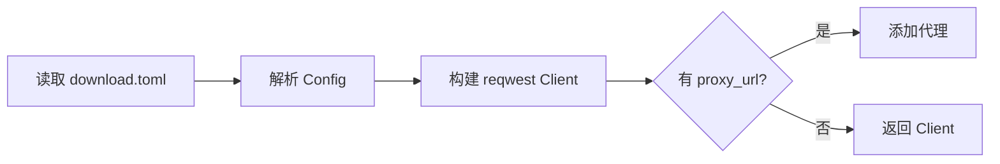
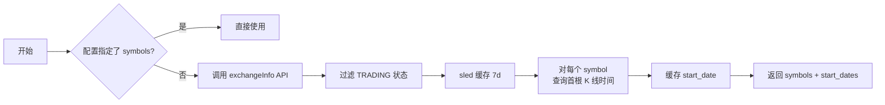
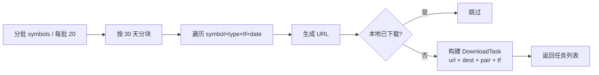
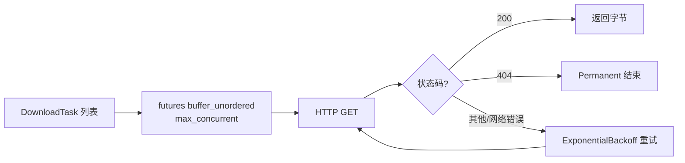
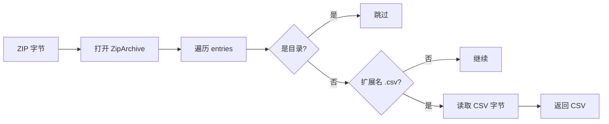
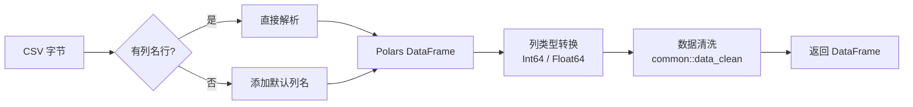

# 介绍

从 Binance Public Data 下载历史 K 线数据，解压 CSV 并转换为 Parquet 格式。

# 配置

```toml
proxy_url = "socks5h://127.0.0.1:7890"
# market_type = ["futures"]
# max_concurrent = 1000
# data_dir = "./data"
# symbols = ["BTCUSDT", "ETHUSDT"]
# timeframes = ["1m", "5m", "15m"]
# start_date = "2020-01-01"
# end_date = "2025-01-01"
# log_level = "info"
```

# 执行流程














# 用法

```bash
cargo run -p data-downloader
```
