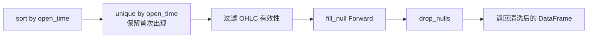

# 介绍

清洗 Parquet K 线数据：按时间排序、去重、过滤无效 OHLC（high >= low/close/open, low <= close/open）、前向填充空值、删除剩余空行。

# 配置

```toml
data_dir = "/data/nutilustrader/data/futures/um/daily/klines"
```

# 执行流程

```mermaid
flowchart LR
  A[Config { data_dir }] --> B[递归扫描 .parquet 文件]
  B --> C{文件列表为空?}
  C -->|是| D[退出]
  C -->|否| E[遍历每个文件]
  E --> F[ParquetReader 加载]
  F --> G{DataFrame 为空?}
  G -->|是| H[跳过]
  G -->|否| I[sort(open_time)]
  I --> J[unique(open_time)]
  J --> K[filter(high>=low & high>=close & ...)]
  K --> L[forward_fill nulls]
  L --> M[drop_nulls]
  M --> N[原子覆盖写回 .parquet.tmp → rename]
  N --> E
```



# 用法

```bash
cargo run -p data-clean -- path/to/clean.toml
```
