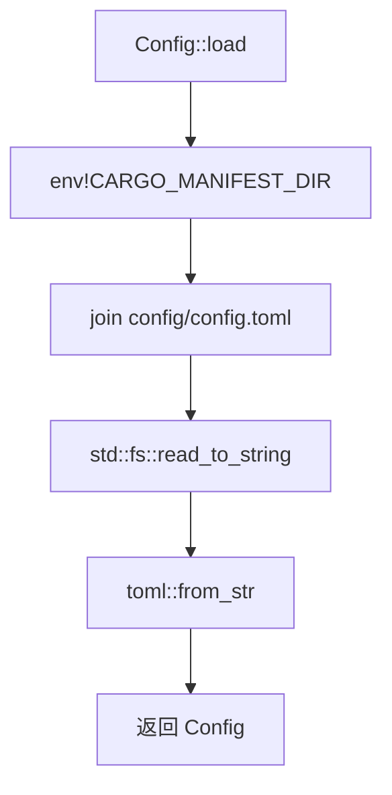
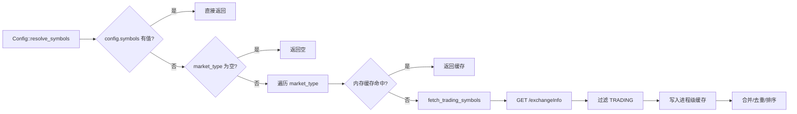
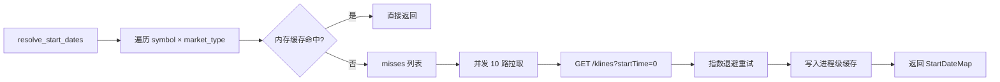
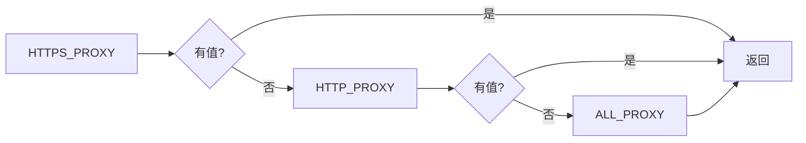

# 配置模块

```
src/config/
├── mod.rs          # 模块声明, 重导出
├── default.rs      # Config 结构体, 加载/解析/默认值
├── get_proxy.rs    # 代理地址读取 (环境变量)
├── market_type.rs  # MarketType 枚举 + 关联 URL/路径方法
├── start_date.rs   # 每个交易对的起始日期解析 (内存缓存)
└── symbols.rs      # 交易对列表解析 (内存缓存, 自动或手动)
```

## Config 结构体

```rust
pub struct Config {
    pub symbols:       Option<Vec<String>>,
    pub timeframes:    Option<Vec<String>>,
    pub market_type:   Vec<MarketType>,
    pub max_concurrent: usize,
    pub data_dir:      PathBuf,
    pub start_date:    Option<String>,
    pub end_date:      Option<String>,
}
```

## 加载流程



## 交易对解析 `symbols.rs`



## 起始日期解析 `start_date.rs`



## 代理优先级

环境变量链路: `HTTPS_PROXY` → `https_proxy` → `HTTP_PROXY` → `http_proxy` → `ALL_PROXY` → `all_proxy`。通过 `dotenvy` 从 `.env` 载入。



## 默认值

| 字段 | 默认值 | 说明 |
|------|--------|------|
| `symbols` | `None` | 自动获取 |
| `timeframes` | 1m/3m/5m/…/1d | 12个标准周期 |
| `market_type` | `[Futures]` | 永续合约 |
| `max_concurrent` | `1000` | 并发数 |
| `data_dir` | `data` | 数据目录 |
| `start_date` | `None` | 从交易所获取 |
| `end_date` | 当天 | — |
